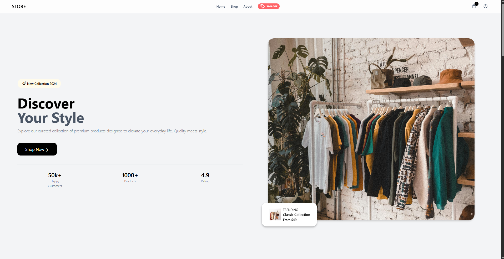
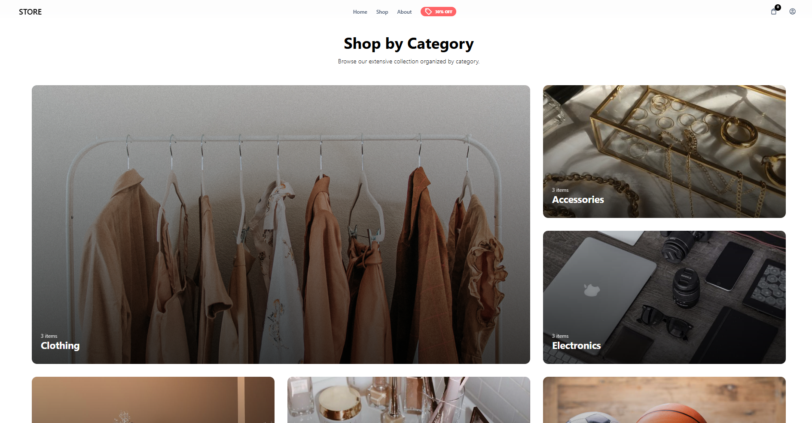
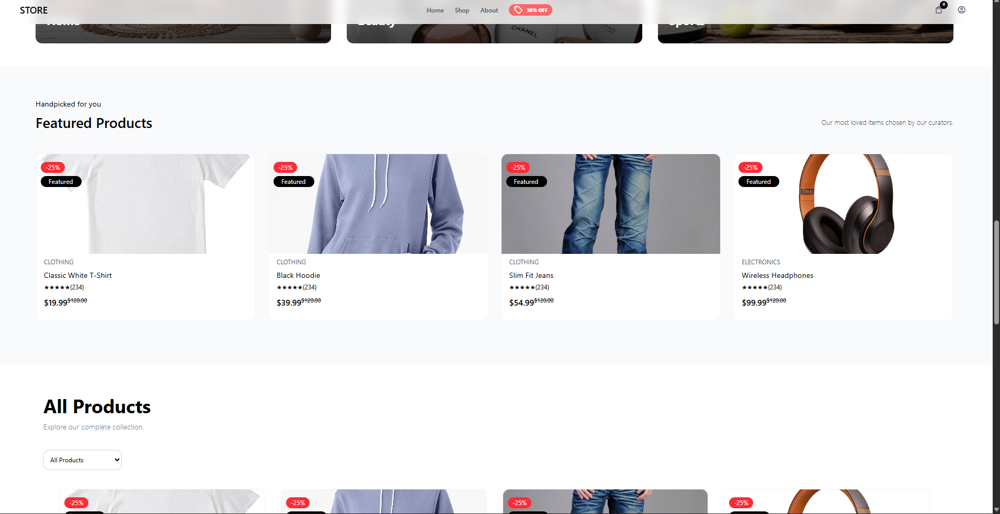
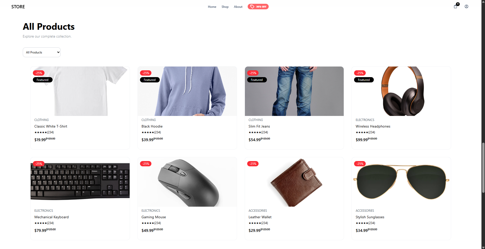
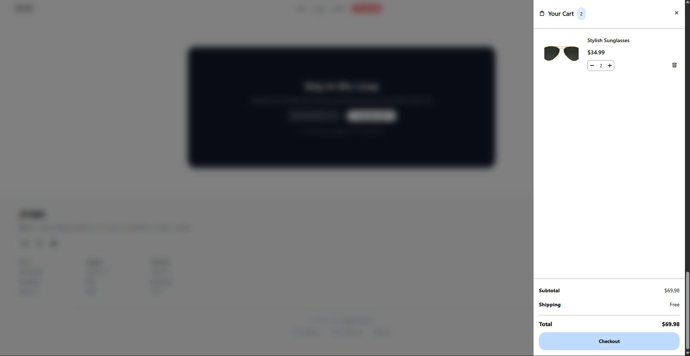
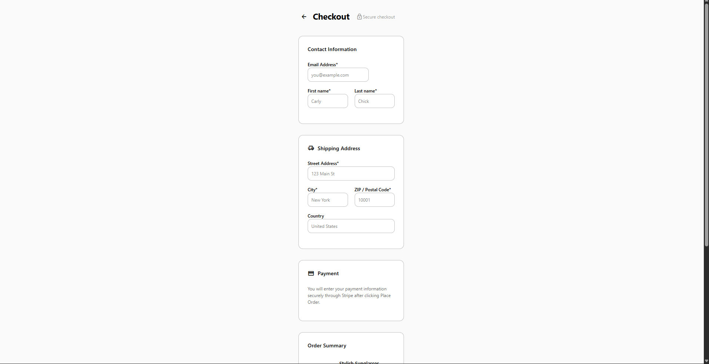

# E-Commerce Store

A full-stack e-commerce web application built with **React, TypeScript, Tailwind CSS, Node.js, Express, and MySQL**. The project brings together a responsive storefront, product discovery, shopping cart management, user authentication, and a checkout flow, with a RESTful backend supporting product and customer data.

## Features

### Storefront and product discovery
- Responsive landing page with a promotional hero section and featured products.
- Visual category browsing with image-based category cards.
- Product catalog with category filtering and pagination.
- Product cards displaying images, prices, discount labels, and ratings.
- Product quick-view modal with descriptions, availability, and quantity controls.

### Shopping cart
- Add products to the cart with a selected quantity.
- Update item quantities or remove products from the cart.
- Slide-out cart panel with dynamically calculated subtotals and totals.
- **Zustand** for client-side cart state management.

### Authentication and checkout
- Backend authentication endpoints for registration, login, and logout.
- Session-based authentication architecture using Express sessions and Redis.
- Checkout form for contact information and shipping address.
- Order summary displaying quantities, pricing, and shipping.
- Checkout interface for entering shipping details and reviewing an order; payment processing is not implemented.

### Backend and data
- **Node.js and Express** REST APIs for application data and workflows.
- **MySQL** for persistent relational data.
- Separation of frontend components, API calls, backend routes, and data access.
- Environment-based configuration for services and credentials.

## Tech Stack

| Layer | Technologies |
| --- | --- |
| Frontend | React, TypeScript, JavaScript, Tailwind CSS |
| State management | Zustand |
| Backend | Node.js, Express.js, REST APIs |
| Database | MySQL |
| Sessions | Express Session, Redis / Upstash |

## Architecture

```text
React + TypeScript + Tailwind CSS
              |
       REST API requests
              |
        Node.js / Express
          /         \
      MySQL      Redis sessions
```

The React client handles the shopping experience and communicates with the Express server through API requests. The server manages application logic and persistent data, while the cart's interactive state is managed in the frontend.

## Screenshots

### Home page


### Shop by category


### Product catalog


### Product quick view


### Shopping cart


### Checkout


## Running Locally

**Prerequisites:** Node.js, npm, MySQL, and the environment variables required by the server.

1. Clone the repository.
2. Install dependencies in the frontend and backend directories.
3. Configure the database and required environment variables locally. Do not commit `.env` files or credentials.
4. Start the backend and frontend development servers using their configured npm scripts.

> The exact setup commands, database initialization steps, and environment variable names depend on the repository configuration.

## Project Status

The storefront, product browsing, cart interactions, and checkout interface are implemented. Backend integration and session infrastructure are part of the project. The checkout interface does not process payments.

## What I Built

This project gave me hands-on experience designing a full-stack application, connecting a React frontend to Express REST APIs, working with relational data in MySQL, managing interactive cart state, and building a multi-step shopping experience. I focused on reusable components, clear separation of concerns, and responsive UI design.
